# HeatBill

HeatBill – это высоконагруженная IoT-система для автоматизированного учёта теплопотребления в многоквартирных домах.
Проект предназначен для сбора данных с датчиков радиаторов отопления, их обработки, выставления счетов жильцам и управления потреблением через ТСЖ.

## Ключевые компоненты системы
- **Жильцы**: получают данные о потреблении тепла и счетах через личный кабинет.
- **ТСЖ**: управляет тарифами, начислениями, анализирует потребление.
- **Датчики отопления**: передают данные о температуре в реальном времени.
- **Система расчёта**: вычисляет стоимость потребления и выставляет счета.

## Формирование требований
### 1. Количество пользователей и устройств
- **Количество датчиков**: 300–600 датчиков в одном многоквартирном доме.
  - Среднестатистический многоквартирный дом включает 100-300 квартир.
  - В каждой квартире может быть 1–3 радиатора, в зависимости от планировки и этажности.
- **Количество одновременных соединений**: 100–200 активных пользователей.
  - В среднем 15-25% жильцов одновременно используют сервисы системы.
  - Если в доме 400 жильцов, активность 20% даст 80 пользователей одновременно.
  - При расширении до 10 домов, эта цифра возрастет до 100–200 пользователей.
- **Масштабируемость**: поддержка десятков домов и тысяч датчиков.
  - При 10 домах общее количество датчиков составит: 10×600 = 6000 датчиков.
  - Количество пользователей: 10×200 = 2000 пользователей.

### 2. Требования по времени отклика
- **API-запросы (чтение данных, получение счёта)** – до **300 мс**.
  - Пользовательские запросы идут к базе данных (**MongoDB**).
  - Среднее время выборки данных в **MongoDB** при индексации – **10–50 мс**.
  - Передача данных через API + обработка на сервере – **100–200 мс**.
  - Дополнительное время на сетевую задержку – **до 50 мс**.
  - Итоговое целевое время: **до 300 мс**.

- **Запись данных с датчиков** – в пределах **500 мс**.
  - Датчики передают данные через **MQTT** (**типичные задержки 10–50 мс**).
  - Данные проходят через **EMQX** и **IoT Controller** (**50–100 мс**).
  - Запись в **MongoDB** (включая валидацию) занимает **200–300 мс**.
  - Общий лимит на все этапы – **500 мс**.

### 3. Объём хранимых данных
- **За 1 месяц**: миллионы записей.
  - Один датчик передает данные каждые 10 секунд → 6 записей в минуту.
  - За сутки один датчик создаст 6 × 60 × 24 = 8 640 записей.
  - В доме с 600 датчиками за сутки: 600 × 8640 = 5 184 000 записей.
  - За месяц: 5 184 000 × 30 = 155 520 000 записей.
  - Для 10 домов: 1 555 200 000 записей (≈1.56 млрд).
- **Рост БД**: зависит от увеличения числа домов.
  - Если одна запись занимает 100 байт, то за месяц: 1.56 млрд × 100 байт = 156 ГБ.
  - При росте числа домов до 50, это будет 780 ГБ в месяц.
- **Логирование (MongoDB + ELK)**:
  - До 1 млн логов в день.
  - Средний лог занимает 100-500 байт.
  - Объём логов: 100–500 МБ в день → 3–15 ГБ в месяц.

## Компоненты проекта
1. **Датчики отопления**
   - Устанавливаются на радиаторах в квартирах.
   - Отправляют данные по MQTT в EMQX брокер.
2. **EMQX (MQTT брокер)**
   - Принимает данные от датчиков.
   - Перенаправляет их в IoT Controller.
3. **IoT Controller**
   - Валидация сообщений.
   - Запись данных в MongoDB.
   - Отправка сообщений в RabbitMQ.
   - Логирование в ELK.
4. **Rule Engine + Redis**
   - Обрабатывает данные по заданным правилам.
   - Логирование в ELK.
   - При отклонениях – уведомляет ТСЖ.
5. **MongoDB + Mongo Express**
   - Хранит историю потребления тепла.
6. **Сервис расчёта платежей**
   - Расчёт стоимости отопления.
   - Выставление счетов жильцам.
7. **Личный кабинет жильца**
   - Просмотр потребления и оплаты.
8. **Личный кабинет ТСЖ**
   - Управление тарифами и настройками.

## Diagrams

## Use-case

### Non-UML

### Components

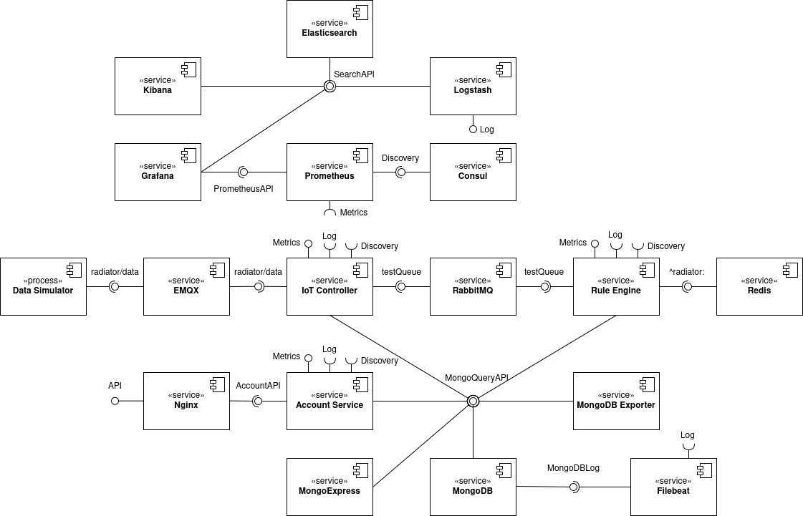

### Deployment

## Infrastructure

See [README.md](./infra/README.md)

## Результаты стресс-тестов с помощью tsung (3 сценария) без масштабирования

Предусмотрены следующие сценарии:

1. Много пользователей с низкой частотой запросов от каждого (300 users, 60 rps).
2. Мало пользователей, но высокая частота запросов от каждого (100 users, 200 rps).
3. Пиковая нагрузка с большим количеством пользователей и высокой частотой запросов (500 users, 400 rps).

### Результаты 1-го сценария (300 users, 60 rps)

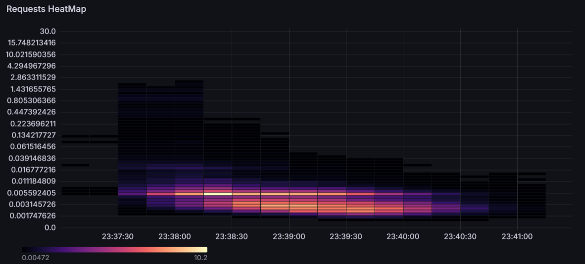
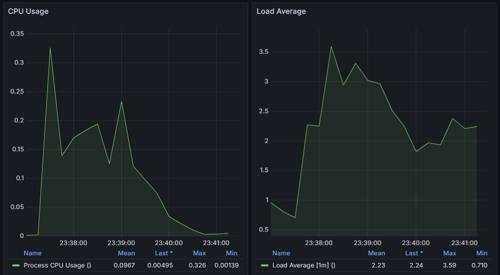
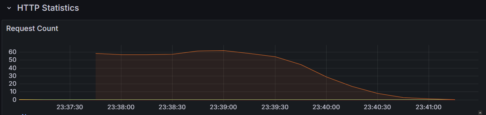
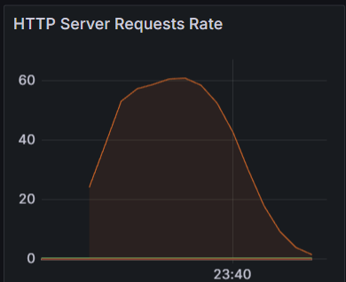

В пределах нормы, соответствует необходимым требованиям.

### Результаты 2-го сценария (100 users, 200 rps)

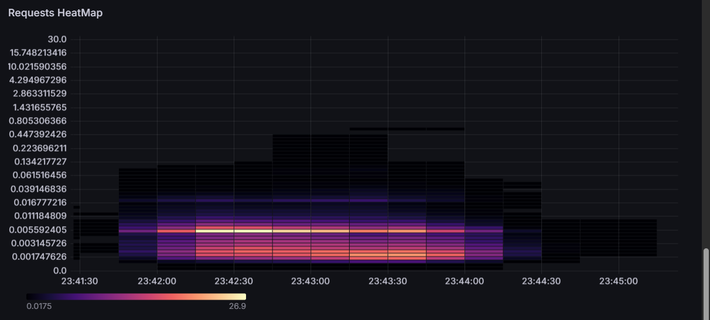
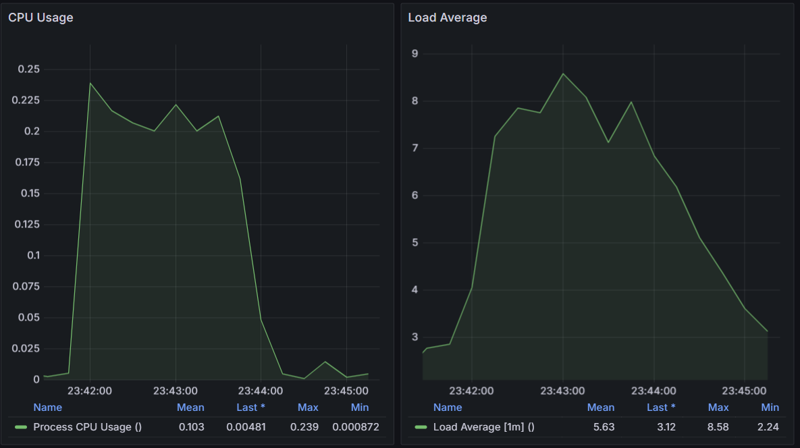
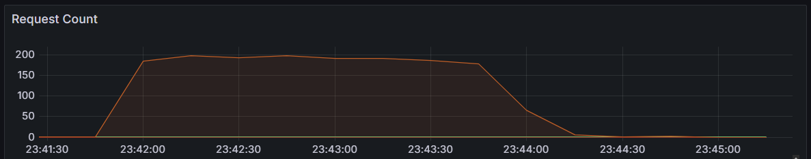
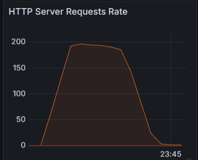

В пределах нормы, соответствует необходимым требованиям.

### Результаты 3-го сценария (500 users, 400 rps)

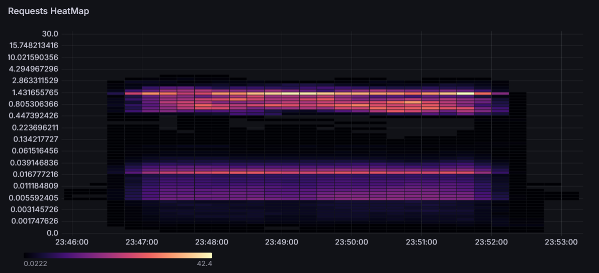
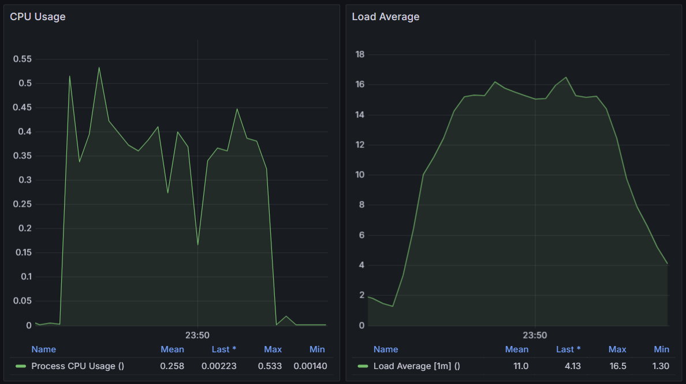
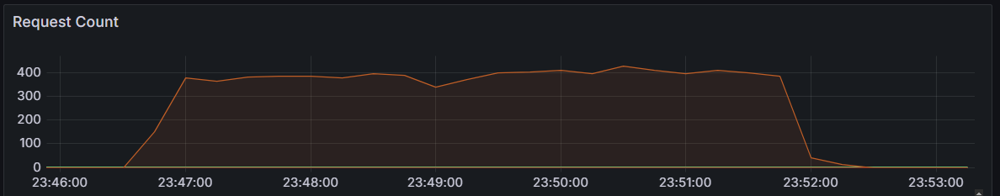
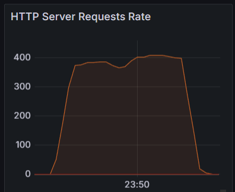

Судя по графику HeatMap большинство запросов находится в пределах 0.8-2 секунды, что уже не соответствует требованиям,
даже с учётом того, что это пиковая нагрузка и она не предполагается в штатном режиме.

Однако тестирование проводилось на самом сложном запросе (расчёт и выставление счёта), следовательно, есть места, которые можно оптимизировать.
Из очевидного, настроить масштабирование для создания нескольких нод и распределения нагрузки на них. Далее можно настроить кэширование результатов датчиков,
хотя это достаточно трудная задача в силу TTL кэша. Также можно добавить индексы в БД и подумать над репликацией данных.

## Результаты стресс-тестов с помощью tsung с масштабированием

### Горизонтальное масштабирование

Для проведения тестирования было выбрано следующее количество экземпляров: 1, 3, 5.
Использовался 3-й сценарий tsung (пиковый).
#### 1 экземпляр

Как и было ранее - при пиковой нагрузке один экземпляр не выдаёт требуемые показатели, хотя в целом и справляется.

#### 3 экземпляра

С 3 экземплярами уже намного лучше, каждый выдерживает около 300 rps. По графику HeatMap видно, что время обработки запроса стало лучше, в пределах 0.3-0.5 с. В начале графика - прогрев JVM.
Однако этого всё ещё недостаточно для требований. Хотя, опять же - это пиковая нагрузка, которая не предполагается.

#### 5 экземпляров

Как можно видеть - на HeatMap достаточно ровное распределение, которое находится от 0.3-0.5 также. Т.е. увеличение экземпляров не дало прибавку?
Проблема заключается в том, что мы упёрлись в ограничения физического железа, из-за чего VM не могли выдать производительность больше, чем при 3 экземплярах.

Таким образом, делаем вывод, что **5 экземпляров** точно выдержат пиковую нагрузку.

### Балансировка нагрузки
Мы использовали несколько методов балансировки нагрузки:

1. Round-robin.
2. Least-connections.
3. Random.

Использовался 3-й сценарий tsung (пиковый) и 3 экземпляра (в силу ограничения физических ресурсов).

#### Round-robin

#### Least-connections

#### Random

В результате тестирования был сделан вывод, что оптимальный вариант - Least-connections (стабильнее, больше rps и меньше execution time). Однако неясно, почему при других способах балансировки результаты получаются неадекватными. Также было замечено, что на других способах tsung не может держать постоянный rps.

### Вертикальное масштабирование

Инфраструктура при вертикальном масштабировании частично отличается от инфраструктуры горизонтальной, например Nginx в данной конфигурации не используется, и вместо docker swarm используется docker compose, поскольку система не требует его наличия. Это может частично повлиять на результаты тестирования.

Необходимое количество памяти для начала работы сервиса `account` - 200 MB. Достаточно количество зависит от нагрузки, однако находится в пределах 400 МБ. При дальнейшем увеличении выделяемой памяти с учетом текущей настройки узлов, а именно наличия 6 виртуальных ядер на виртуальной машине `ahla-single-1` не влияет на производительность.

Сервис параллелизуется по ядрам самостоятельно (Spring создает количество тредов согласно количеству виртуальных ядер машины). При выделении 1 ядра сервис может обрабатывать 120 запросов в секунду. При увеличении количество ядер, а именно до 2 и 4, система обрабатывает приблизительно 200 и 340 запросов в секунду.

### Необходимые ресурсы системы

Представлены в файлах `infra/terraform/environments/local/tfvars/*`.

Для однонодовой конфигурации с Docker Compose:

- 4 ГБ оперативной памяти
- 4 ядра процессора

Для многоузловой конфигурации (использовавшейся во время тестирования):

- Master узел - 4 ГБ оперативной памяти, до 4 ядер процессора
- Worker узлы - 2 ГБ оперативной памяти, до 2 ядер процессора

Многоузловая конфигурации позволяет запускать до 5 сервисов `account`. Дальнейшее увеличение количества сервисов нецелесообразно по причине ограниченности ресурсов по памяти и по CPU комбинированно.
