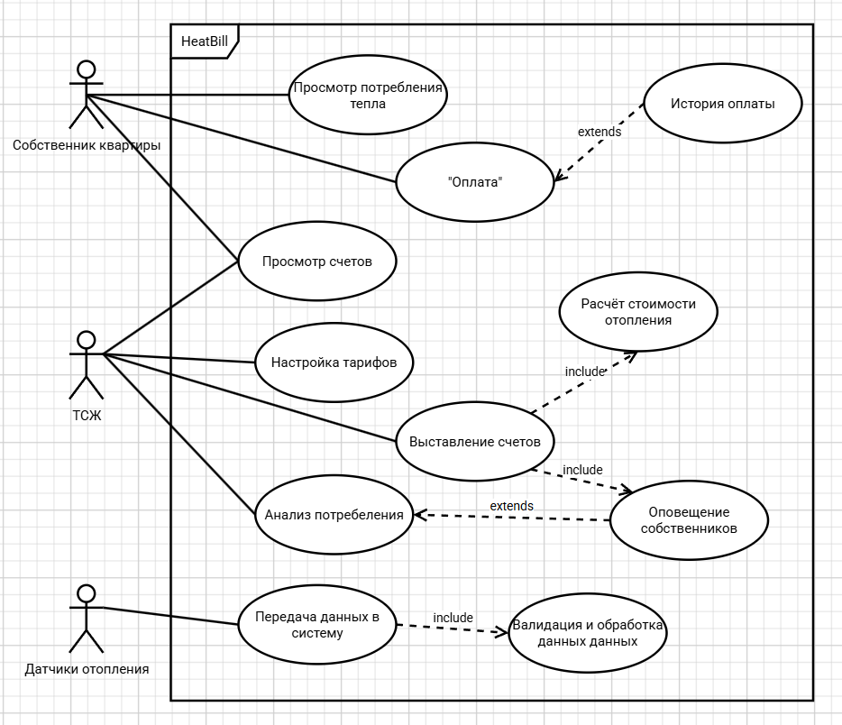
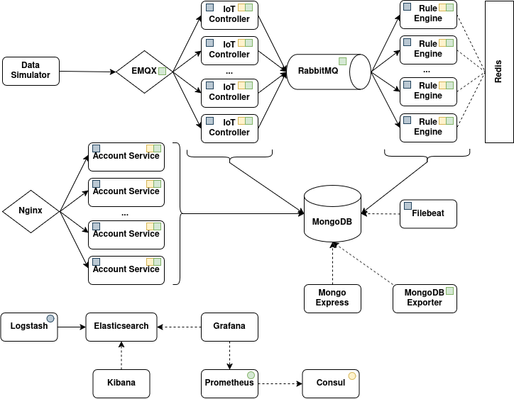
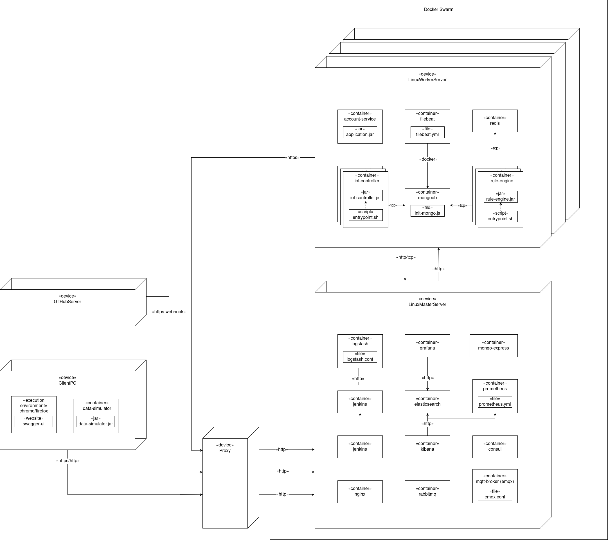

# HeatBill

HeatBill – это высоконагруженная IoT-система для автоматизированного учёта теплопотребления в многоквартирных домах.
Проект предназначен для сбора данных с датчиков радиаторов отопления, их обработки, выставления счетов жильцам и управления потреблением через ТСЖ.

## Ключевые компоненты системы
- **Жильцы**: получают данные о потреблении тепла и счетах через личный кабинет.
- **ТСЖ**: управляет тарифами, начислениями, анализирует потребление.
- **Датчики отопления**: передают данные о температуре в реальном времени.
- **Система расчёта**: вычисляет стоимость потребления и выставляет счета.

## Формирование требований
### 1. Количество пользователей и устройств
- **Количество датчиков**: 300–600 датчиков в одном многоквартирном доме.
  - Среднестатистический многоквартирный дом включает 100-300 квартир.
  - В каждой квартире может быть 1–3 радиатора, в зависимости от планировки и этажности.
- **Количество одновременных соединений**: 100–200 активных пользователей.
  - В среднем 15-25% жильцов одновременно используют сервисы системы.
  - Если в доме 400 жильцов, активность 20% даст 80 пользователей одновременно.
  - При расширении до 10 домов, эта цифра возрастет до 100–200 пользователей.
- **Масштабируемость**: поддержка десятков домов и тысяч датчиков.
  - При 10 домах общее количество датчиков составит: 10×600 = 6000 датчиков.
  - Количество пользователей: 10×200 = 2000 пользователей.

### 2. Требования по времени отклика
- **API-запросы (чтение данных, получение счёта)** – до **300 мс**.
  - Пользовательские запросы идут к базе данных (**MongoDB**).
  - Среднее время выборки данных в **MongoDB** при индексации – **10–50 мс**.
  - Передача данных через API + обработка на сервере – **100–200 мс**.
  - Дополнительное время на сетевую задержку – **до 50 мс**.
  - Итоговое целевое время: **до 300 мс**.

- **Запись данных с датчиков** – в пределах **500 мс**.
  - Датчики передают данные через **MQTT** (**типичные задержки 10–50 мс**).
  - Данные проходят через **EMQX** и **IoT Controller** (**50–100 мс**).
  - Запись в **MongoDB** (включая валидацию) занимает **200–300 мс**.
  - Общий лимит на все этапы – **500 мс**.

### 3. Объём хранимых данных
- **За 1 месяц**: миллионы записей.
  - Один датчик передает данные каждые 10 секунд → 6 записей в минуту.
  - За сутки один датчик создаст 6 × 60 × 24 = 8 640 записей.
  - В доме с 600 датчиками за сутки: 600 × 8640 = 5 184 000 записей.
  - За месяц: 5 184 000 × 30 = 155 520 000 записей.
  - Для 10 домов: 1 555 200 000 записей (≈1.56 млрд).
- **Рост БД**: зависит от увеличения числа домов.
  - Если одна запись занимает 100 байт, то за месяц: 1.56 млрд × 100 байт = 156 ГБ.
  - При росте числа домов до 50, это будет 780 ГБ в месяц.
- **Логирование (MongoDB + ELK)**:
  - До 1 млн логов в день.
  - Средний лог занимает 100-500 байт.
  - Объём логов: 100–500 МБ в день → 3–15 ГБ в месяц.

## Компоненты проекта
1. **Датчики отопления**
   - Устанавливаются на радиаторах в квартирах.
   - Отправляют данные по MQTT в EMQX брокер.
2. **EMQX (MQTT брокер)**
   - Принимает данные от датчиков.
   - Перенаправляет их в IoT Controller.
3. **IoT Controller**
   - Валидация сообщений.
   - Запись данных в MongoDB.
   - Отправка сообщений в RabbitMQ.
   - Логирование в ELK.
4. **Rule Engine + Redis**
   - Обрабатывает данные по заданным правилам.
   - Логирование в ELK.
   - При отклонениях – уведомляет ТСЖ.
5. **MongoDB + Mongo Express**
   - Хранит историю потребления тепла.
6. **Сервис расчёта платежей**
   - Расчёт стоимости отопления.
   - Выставление счетов жильцам.
7. **Личный кабинет жильца**
   - Просмотр потребления и оплаты.
8. **Личный кабинет ТСЖ**
   - Управление тарифами и настройками.

## Diagrams

## Use-case



### Non-UML



### Components


### Deployment



## Deployment

### Dev

```sh
docker compose up -d
```

Default values for environment variables are present in `docker-compose.yml`. Can be overridden.

Deployment attributes are present in `docker-compose.override.yml`.

See services configuration files for additional modifications.

Grafana dashboard JSONs are located at `grafana/`. They require `prometheus` data source to be configured. Default `prometheus` URL is `http://prometheus:9090` when in the same docker network. Manually update dashboard JSONs with generated dashboard `datasource` `uid`.

### Jenkins

Create external volume for `jenkins`:

```sh
docker volume create ahla-jenkins-home
```

By default `jenkins-agent` uses `sysbox` container runtime. Can be changed to docker socket binding by mounting socket as a volume.

Deploy:

```sh
docker compose -f docker-compose.jenkins.yml up -d
```

Before deployment add environment variables:

- `JENKINS_PORT` - port for jenkins controller
- `JENKINS_AGENT_SSH_PUBKEY` - public key for jenkins agent

Pipeline is located at `jenkins/jenkinsfile`.

> Note: The `GitHubCommitStatusSetter` requires that the Git Server is defined under _Manage Jenkins > Configure System > GitHub > GitHub Servers_. Otherwise the `GitHubCommitStatusSetter` is not able to resolve the repository name properly and you would see an empty list of repos:

```
[...]
[Set GitHub commit status (universal)] PENDING on repos [] (sha:xxxxxxx) with context:test/mycontext
[...]
```

Installed `jenkins` plugins:

```
"ant 513.vde9e7b_a_0da_0f"
"antisamy-markup-formatter 173.v680e3a_b_69ff3"
"apache-httpcomponents-client-4-api 4.5.14-269.vfa_2321039a_83"
"apache-httpcomponents-client-5-api 5.4.3-140.v2516ccde99e7"
"asm-api 9.8-135.vb_2239d08ee90"
"authentication-tokens 1.131.v7199556c3004"
"bootstrap5-api 5.3.3-2"
"bouncycastle-api 2.30.1.80-256.vf98926042a_9b_"
"branch-api 2.1217.v43d8b_b_d8b_2c7"
"build-timeout 1.38"
"caffeine-api 3.2.0-166.v72a_6d74b_870f"
"checks-api 367.v18b_7f530e54a_"
"cloud-stats 377.vd8a_6c953e98e"
"cloudbees-folder 6.1012.v79a_86a_1ea_c1f"
"commons-compress-api 1.27.1-3"
"commons-lang3-api 3.17.0-87.v5cf526e63b_8b_"
"commons-text-api 1.13.0-153.v91dcd89e2a_22"
"coverage 2.3.0"
"credentials-binding 687.v619cb_15e923f"
"credentials 1413.va_51c53703df1"
"dark-theme 524.vd675b_22b_30cb_"
"data-tables-api 2.2.2-1"
"display-url-api 2.209.v582ed814ff2f"
"docker-commons 451.vd12c371eeeb_3"
"docker-java-api 3.5.0-108.v211cdd21c383"
"docker-plugin 1274.vc0203fdf2e74"
"docker-workflow 611.v16e84da_6d3ff"
"durable-task 587.v84b_877235b_45"
"echarts-api 5.6.0-3"
"eddsa-api 0.3.0.1-19.vc432d923e5ee"
"email-ext 1876.v28d8d38315b_d"
"font-awesome-api 6.7.2-1"
"forensics-api 3.1.0"
"git-client 6.1.3"
"git 5.7.0"
"github-api 1.321-488.v9b_c0da_9533f8"
"github-branch-source 1815.v9152b_2ff7a_1b_"
"github 1.43.0"
"gradle 2.14.1"
"gson-api 2.12.1-113.v347686d6729f"
"instance-identity 203.v15e81a_1b_7a_38"
"ionicons-api 82.v0597178874e1"
"jackson2-api 2.18.3-402.v74c4eb_f122b_2"
"jakarta-activation-api 2.1.3-2"
"jakarta-mail-api 2.1.3-2"
"javax-activation-api 1.2.0-8"
"jaxb 2.3.9-133.vb_ec76a_73f706"
"jjwt-api 0.11.5-120.v0268cf544b_89"
"joda-time-api 2.14.0-127.v7d9da_295a_d51"
"jquery3-api 3.7.1-3"
"json-api 20250107-125.v28b_a_ffa_eb_f01"
"json-path-api 2.9.0-148.v22a_7ffe323ce"
"jsoup 1.19.1-38.v216a_f3721b_3c"
"junit 1322.v1556dc1c59a_f"
"ldap 780.vcb_33c9a_e4332"
"mailer 489.vd4b_25144138f"
"matrix-auth 3.2.6"
"matrix-project 847.v88a_f90ff9f20"
"metrics 4.2.21-464.vc9fa_a_0d6265d"
"mina-sshd-api-common 2.15.0-161.vb_200831a_c15b_"
"mina-sshd-api-core 2.15.0-161.vb_200831a_c15b_"
"okhttp-api 4.11.0-189.v976fa_d3379d6"
"pam-auth 1.12"
"pipeline-build-step 567.vea_ce550ece97"
"pipeline-github-lib 65.v203688e7727e"
"pipeline-graph-analysis 235.vb_a_a_36b_f248c2"
"pipeline-graph-view 433.v28288510b_b_6d"
"pipeline-groovy-lib 752.vdddedf804e72"
"pipeline-input-step 517.vf8e782ee645c"
"pipeline-milestone-step 127.vb_52887ca_3b_6d"
"pipeline-model-api 2.2254.v2a_978de46f35"
"pipeline-model-definition 2.2254.v2a_978de46f35"
"pipeline-model-extensions 2.2254.v2a_978de46f35"
"pipeline-stage-step 322.vecffa_99f371c"
"pipeline-stage-tags-metadata 2.2254.v2a_978de46f35"
"plain-credentials 195.vb_906e9073dee"
"plugin-util-api 6.1.0"
"prism-api 1.30.0-1"
"resource-disposer 0.25"
"scm-api 704.v3ce5c542825a_"
"script-security 1373.vb_b_4a_a_c26fa_00"
"snakeyaml-api 2.3-125.v4d77857a_b_402"
"ssh-credentials 355.v9b_e5b_cde5003"
"ssh-slaves 3.1031.v72c6b_883b_869"
"structs 343.vdcf37b_a_c81d5"
"theme-manager 278.v2e3c063e42cc"
"timestamper 1.28"
"token-macro 444.v52de7e9c573d"
"trilead-api 2.209.v0e69b_c43c245"
"variant 70.va_d9f17f859e0"
"workflow-aggregator 608.v67378e9d3db_1"
"workflow-api 1371.ve334280b_d611"
"workflow-basic-steps 1079.vce64b_a_929c5a_"
"workflow-cps 4080.va_15b_44a_91525"
"workflow-durable-task-step 1405.v1fcd4a_d00096"
"workflow-job 1508.v9cb_c3a_a_89dfd"
"workflow-multibranch 806.vb_b_688f609ee9"
"workflow-scm-step 437.v05a_f66b_e5ef8"
"workflow-step-api 700.v6e45cb_a_5a_a_21"
"workflow-support 968.v8f17397e87b_8"
"ws-cleanup 0.48"
```
